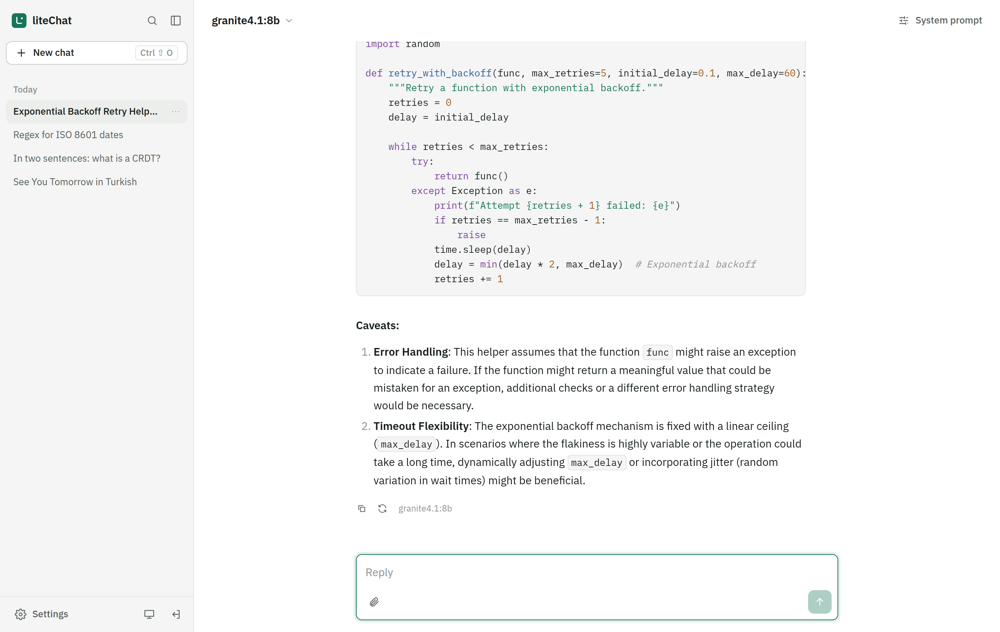
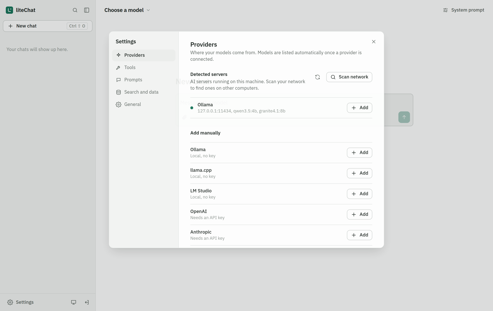
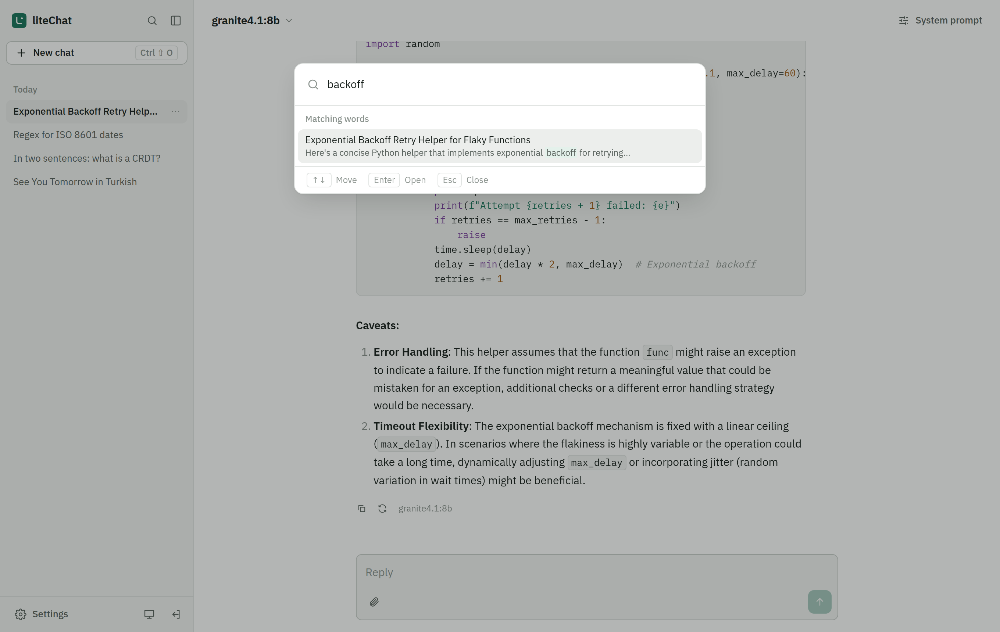
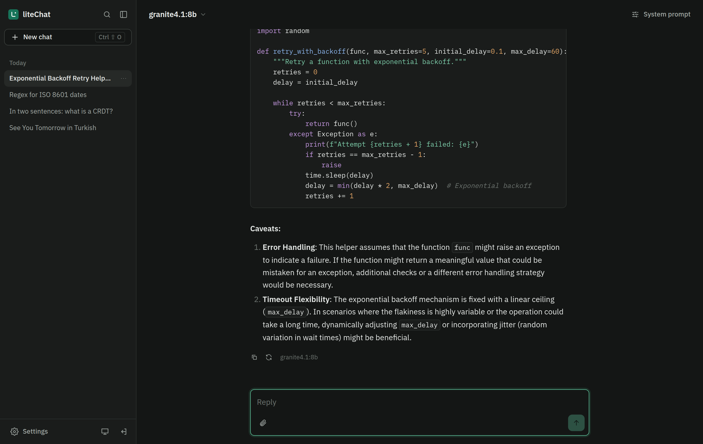
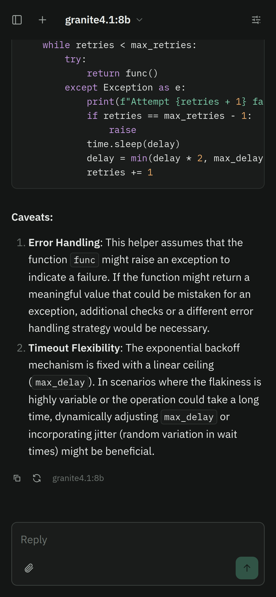

<h1>liteChat</h1>

A lightweight, self-hosted chat UI for local and cloud LLMs.
One ~15 MB binary, one SQLite file, ~25 MB of RAM. Run it on a headless box and use it from any browser.

[](https://github.com/erinoooo/litechat/actions/workflows/ci.yml)
[](https://github.com/erinoooo/litechat/releases/latest)
[](LICENSE)



## Why

Open WebUI is capable, but it's a large Python app whose Docker image runs to several gigabytes.
liteChat keeps the parts people use every day and drops the rest:

|  | liteChat |
|---|---|
| Install | One static binary (~6 MB download), or a ~22 MB Docker image |
| Runtime | No Python, no Node, no external database |
| Memory | ~25 MB at idle |
| First page load | ~80 KB of JavaScript (gzipped); code highlighting and math load on demand |

## Features

- **Any model.** Ollama, llama.cpp, LM Studio, vLLM, OpenRouter, Groq, OpenAI, any OpenAI-compatible server, and Anthropic. Model lists are fetched automatically.
- **Finds local servers for you.** Ollama, LM Studio, llama.cpp, vLLM, KoboldCpp, SGLang and others running on this machine show up in Settings with an Add button. You can also scan your local network.
- **Replies run on the server.** Close the tab, lock your phone or reload mid-answer: the reply keeps going and the page picks it back up.
- **Branching.** Edit a message or regenerate a reply, then switch between versions.
- **Tools through MCP.** Connect [MCP](https://modelcontextprotocol.io) servers (remote or local) so models can search the web, read files, use GitHub and more.
- **Attachments.** Images, PDF, DOCX and text or code files.
- **Search.** Full-text search across every chat (Ctrl+K), plus optional search by meaning using an embedding model you choose.
- **Your data stays yours.** Everything lives in one SQLite file. Import from ChatGPT and Open WebUI; export to JSON or Markdown.
- Reasoning models, code highlighting, math, system-prompt presets, light and dark themes, mobile layout, installable as an app.
- One account, protected by a password. API keys stay on the server.

<table>
  <tr>
    <td></td>
    <td></td>
  </tr>
  <tr>
    <td></td>
    <td align="center"></td>
  </tr>
</table>

## Install

### Binary

Download the archive for your platform from the [latest release](https://github.com/erinoooo/litechat/releases/latest), unpack it and run it:

```sh
tar xzf litechat_*_linux_amd64.tar.gz
cd litechat_*_linux_amd64
./litechat
```

Open http://localhost:3000 and choose a password. Builds are available for Linux, macOS, Windows and FreeBSD on x86-64 and ARM.

### pipx, uv or pip

The same binary is on PyPI as [`litechat-py`](https://pypi.org/project/litechat-py/), for Linux, macOS and Windows:

```sh
pipx install litechat-py      # or: uv tool install litechat-py
litechat
```

To try it without installing: `uvx --from litechat-py litechat`.

### Docker

```sh
docker run -d -p 3000:3000 -v litechat:/data --add-host=host.docker.internal:host-gateway \
  ghcr.io/erinoooo/litechat:latest
```

Or use the included [`docker-compose.yml`](docker-compose.yml). The `--add-host` flag lets liteChat reach Ollama and other servers running on the host.

### From source

Needs Go 1.27+ and Node 24+.

```sh
git clone https://github.com/erinoooo/litechat && cd litechat
make
./litechat
```

## Quick start

1. Start liteChat and open it in your browser.
2. Set a password.
3. Settings opens on **Providers**. If Ollama or another local server is running, it's listed under **Detected servers**: click **Add**. For a cloud provider, pick it under **Add manually** and paste your API key.
4. Choose a model at the top and start typing.

## Configuration

| Flag | Environment variable | Default | |
|---|---|---|---|
| `-addr` | `LITECHAT_ADDR` | `:3000` | Address to listen on |
| `-data` | `LITECHAT_DATA` | see below | Folder for the database |
| | `LITECHAT_PASSWORD` | | Sets or resets the password at startup |
| | `LITECHAT_MCP_STDIO` | | `1` allows local (command-based) MCP servers |
| `-version` | | | Print the version and exit |

By default chats are stored in `~/.local/share/litechat` on Linux, `~/Library/Application Support/litechat` on macOS and `%LocalAppData%\litechat` on Windows. If the current directory has a `data` folder with a database in it (the default before v0.2.0), that is used instead. The startup log shows which folder is in use.

Everything else is set in the app.

## Documentation

- [Providers and local server discovery](docs/providers.md)
- [Tools (MCP)](docs/tools.md)
- [Search, import and export](docs/search-and-data.md)
- [Deploying: systemd, reverse proxies, Docker](docs/deployment.md)
- [HTTP API](docs/api.md)
- [Development and the design system](docs/development.md)

## Status

liteChat is young: it works well day to day, but expect rough edges, and back up your data folder (the startup log shows where it is). Bug reports and ideas are welcome in [issues](https://github.com/erinoooo/litechat/issues). See [CHANGELOG.md](CHANGELOG.md) for what's new.

## License

[MIT](LICENSE)
