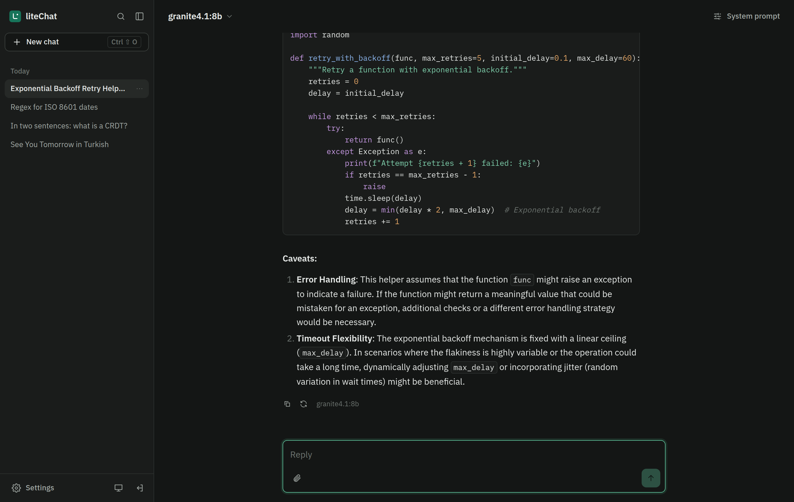

# liteChat

A lightweight, self-hosted chat UI for local and cloud LLMs. It runs as one small binary with one SQLite file: no Python, Node or database server at runtime. This package installs that binary as the `litechat` command.



## Install and run

```sh
pipx install litechat-py      # or: uv tool install litechat-py, or pip install litechat-py
litechat
```

Or run it once without installing: `uvx --from litechat-py litechat`.

Open http://localhost:3000 and choose a password. liteChat finds AI servers running on the machine, such as Ollama, llama.cpp or LM Studio, and adds them in one click. You can also add OpenAI-compatible APIs and Anthropic.

Chats are stored in `~/.local/share/litechat` on Linux, `~/Library/Application Support/litechat` on macOS and `%LocalAppData%\litechat` on Windows. Use `-data <folder>` to store them somewhere else, and `-addr` to change the listen address (for example `-addr 127.0.0.1:8080`).

Wheels are available for Linux (x86-64, ARM64, ARMv7), macOS 12+ (Intel and Apple Silicon) and Windows (x86-64, ARM64). For other platforms, use a [release download](https://github.com/erinoooo/litechat/releases) or the Docker image.

## Features

- Streaming chat with branching: edit messages, regenerate replies, switch between versions
- Replies generate on the server, so they survive closed tabs
- Tools through MCP servers
- Images, PDF, DOCX and code attachments
- Full-text search, and optional search by meaning
- Import from ChatGPT and Open WebUI; export to JSON or Markdown

Documentation, Docker setup and source code: https://github.com/erinoooo/litechat
